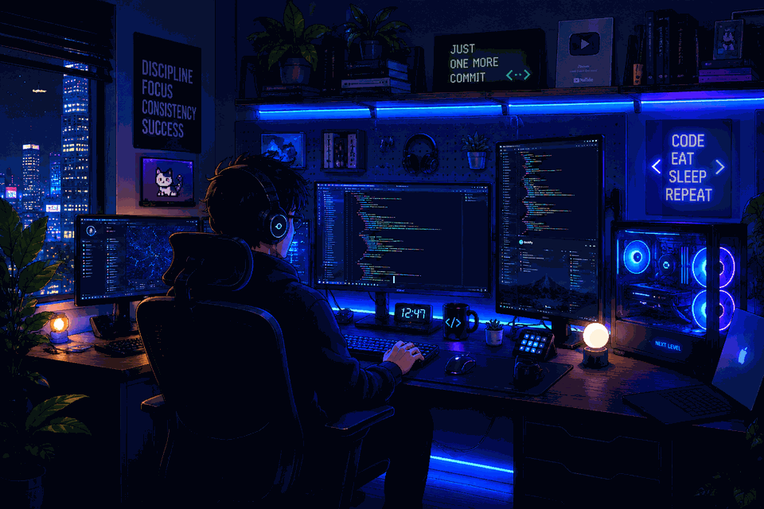

<!-- ⚡ Animated wave banner -->

<!-- ⌨️ Animated typing intro -->

  

 

<!-- 👀 Visitor counter + status badges -->

  
  
  

<!-- 🔗 Social badges -->

  
  
  
  
  

<!-- 🖼️ Banner gif -->

  

---

## 🧰 Tech Arsenal

  

  <code>LLM Evaluation</code> • <code>Agentic Coding</code> • <code>Benchmark Engineering</code> • <code>AI Infrastructure</code>

---

## 🏗️ Featured Work

<table>
<tr>
<td width="50%" valign="top">

### 🧠 Smart LLM Router
Intelligent routing layer that directs queries to the optimal model by complexity, cutting inference cost and latency without sacrificing response quality.

**Python · FastAPI · React · TypeScript · Gemini API**

[**Repository →**](https://github.com/AnkitPorwal04/smart-llm-router)

</td>
<td width="50%" valign="top">

### 🎨 ImaginAI
Full-stack image-generation platform serving prompt-driven synthesis through an interactive web app, with async inference and managed auth.

**React · Flask · Stable Diffusion · Hugging Face · Firebase**

[**Repository →**](https://github.com/AnkitPorwal04/ImaginAI) &nbsp;·&nbsp; [**Live Demo →**](https://imgenai.vercel.app/)

</td>
</tr>
<tr>
<td width="50%" valign="top">

### 📚 RAG App
Retrieval-augmented generation system pairing semantic search with LLM reasoning to answer questions over custom document collections.

**Python · LangChain · FAISS · OpenAI · Streamlit**

[**Repository →**](https://github.com/AnkitPorwal04/RAG_Project)

</td>
<td width="50%" valign="top">

### 🚗 Self-Drive Guardian
Real-time driver-monitoring system using computer vision to detect drowsiness, built on a low-latency YOLO inference pipeline.

**Python · YOLO · OpenCV · TensorFlow**

[**Repository →**](https://github.com/AnkitPorwal04/drowsy_driver_web)

</td>
</tr>
</table>

---

## 🚀 Currently Building

- **Frontier LLM Evaluation** — reproducible, sandboxed harnesses for scoring coding agents
- **Agentic Coding Systems** — pipelines that execute, verify, and self-correct model output
- **AI Infrastructure** — containerized, deterministic benchmark environments
- **Benchmark Engineering** — quality assurance and data-contamination detection at scale
- **Open-source AI Tooling** — developer tools for building and evaluating LLM systems

---

## 📊 GitHub Statistics

  
  

  

  

  <a href="https://ankitporwal04.github.io/github-stats-dashboard/"><b>Full interactive dashboard →</b></a>

---

## 🐍 Contribution Snake

  

---

## ✍️ Writing

I occasionally write about applied AI and engineering on [**Medium →**](https://medium.com/@porwalankit04)

- [130 Billion Tokens at the Edge of Infinity](https://medium.com/@porwalankit04/130-billion-tokens-at-the-edge-of-infinity-77effca236a2)
- [Your Coding Agent Isn’t Solving the Bug. It’s Downloading the Answer.](https://medium.com/@porwalankit04/your-coding-agent-isnt-solving-the-bug-it-s-downloading-the-answer-b2f286f0e8fb)
- [How Generative AI Is Changing Creative Work](https://medium.com/@porwalankit04/how-generative-ai-is-changing-creative-work-18286c2a87f7)
- [What Are Large Language Models (LLMs)?](https://medium.com/@porwalankit04/what-are-large-language-models-llms-55c303ec3b05)

---

<!-- 🌊 Animated footer -->

  
  
  
  

